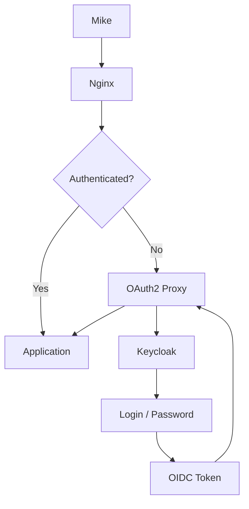

# OAuth 2.0 Authentication Implementation

## Context

Traditionally, accessing a protected service often meant providing credentials directly. OAuth introduced delegated authorization, allowing applications to receive limited access through tokens instead of handling the user's password.

OAuth 2.0 standardized and expanded this model for modern web applications and API architectures.

## Stack

The purpose of this documentation is to implement an OAuth 2.0/OIDC authentication solution for a web application.

* Web application: a very basic [Nginx](https://nginx.org/en/docs/index.html) web application consisting of a single `index.html` page.
* Authentication server: [Keycloak](https://www.keycloak.org/documentation).
* Infrastructure:
  * Ubuntu 24.04 running under WSL2.
  * [Docker](https://docs.docker.com/).

Our Docker stack consists of three services:

* `nginx`: our web application and reverse proxy.
* `oauth2-proxy`: handles the OIDC authentication flow and redirects users to Keycloak when authentication is required.
* `keycloak`: our identity and authentication server.

## Requirements

* Update the `/etc/hosts` file. On Windows, the equivalent file is located at:

  ```text
  C:\Windows\System32\drivers\etc\hosts
  ```

  Add:

  ```text
  127.0.0.1   localhost keycloak
  ```

* WSL2 or another hypervisor such as Hyper-V, VMware, or VirtualBox.
  * [WSL installation documentation](https://learn.microsoft.com/en-us/windows/wsl/install)

```powershell
PS C:\> wsl --version
WSL version: 2.6.3.0
Kernel version: 6.6.87.2-1
WSLg version: 1.0.71
MSRDC version: 1.2.6353
Direct3D version: 1.611.1-81528511
DXCore version: 10.0.26100.1-240331-1435.ge-release
Windows version: 10.0.26200.9711
```

* Docker
  * [Docker installation on Ubuntu documentation](https://docs.docker.com/engine/install/ubuntu/)

```bash
$ docker version
Client: Docker Engine - Community
 Version:           29.9.2
 API version:       1.56
 Go version:        go1.26.10
 Git commit:        a82e528
 Built:             Tue Oct 20 18:44:40 2026
 OS/Arch:           linux/amd64
 Context:           default

Server: Docker Engine - Community
 Engine:
  Version:          29.9.2
  API version:      1.56 (minimum version 1.40)
  Go version:        go1.26.10
  Git commit:        0367cbe
  Built:             Tue Oct 20 18:44:40 2026
  OS/Arch:           linux/amd64
  Experimental:     false
 containerd:
  Version:          v2.4.2
  GitCommit:        b7a25261e029d68978bbf290df0a62fc819b3c51
 runc:
  Version:          1.5.2
  GitCommit:        v1.5.2-0-g29dd3dc2
 docker-init:
  Version:          0.19.0
  GitCommit:        de40ad0
```

## Stack

### Authentication Diagram



As described above, our stack runs using Docker Compose. For each service, I will describe its `docker-compose.yaml` block and configuration.

### Requirements

Before configuring the services, we need to create a common Docker network.

In the `docker-compose.yaml` file:

```yaml
services:
    # nginx
    # oauth2-proxy
    # keycloak

networks:
    web:
```

The Docker network will be created automatically the first time we run:

```bash
docker compose up
```

We can verify that the network has been created with:

```bash
$ docker network ls
NETWORK ID     NAME         DRIVER    SCOPE
0072503fa7f2   bridge       bridge    local
0e7185d1e2c6   host         host      local
10756ce2dcea   none         null      local
7f1b97eabaca   oauth2_web   bridge    local # <-- Docker network created by Docker Compose
```

### Nginx

#### Docker Compose Block

**What do we need?**

* A Docker image: `nginx:stable-alpine3.24-slim`, available on Docker Hub. Keep in mind that using the `latest` tag is generally not recommended.
* Port mapping: we want to access our web application through port `8080` on the host, mapped to port `80` inside the container.
* Two volumes:
  * The Nginx configuration.
  * The HTML index page.
* A dependency on the `oauth2-proxy` service, which itself depends on Keycloak.
* The shared `web` network.

Docker Compose configuration:

```yaml
services:
  nginx:
    image: nginx:stable-alpine3.24-slim
    container_name: nginx
    ports:
      - "8080:80"
    volumes:
      - ./nginx.conf:/etc/nginx/conf.d/default.conf:ro
      - ./html:/usr/share/nginx/html:ro
    depends_on:
      oauth2-proxy:
        condition: service_started
    networks:
      - web

networks:
  web:
```

#### Nginx Configuration

```conf
server {
    listen 80;
    server_name localhost;

    location = /oauth2/auth {
        internal;

        proxy_pass http://oauth2-proxy:4180/oauth2/auth;

        proxy_set_header X-Original-URI $request_uri;
        proxy_set_header X-Real-IP $remote_addr;

        proxy_pass_request_body off;
        proxy_set_header Content-Length "";
    }

    location /oauth2/ {
        proxy_pass http://oauth2-proxy:4180;

        proxy_set_header Host $host;
        proxy_set_header X-Real-IP $remote_addr;
        proxy_set_header X-Forwarded-Proto $scheme;
        proxy_set_header X-Auth-Request-Redirect $request_uri;
    }

    location / {
        auth_request /oauth2/auth;
        error_page 401 = /oauth2/sign_in;

        root /usr/share/nginx/html;
        index index.html;
    }
}
```

| Nginx directive | Description |
|---|---|
| `listen 80` | Listens for incoming HTTP connections on port `80`. |
| `server_name localhost` | Defines `localhost` as the hostname handled by this server block. |
| `location = /oauth2/auth` | Defines the internal endpoint used to check whether a request is authenticated. |
| `internal` | Prevents clients from accessing `/oauth2/auth` directly. |
| `proxy_pass http://oauth2-proxy:4180/oauth2/auth` | Forwards authentication checks to OAuth2 Proxy. |
| `proxy_set_header X-Original-URI $request_uri` | Sends the originally requested URI to OAuth2 Proxy. |
| `proxy_set_header X-Real-IP $remote_addr` | Sends the client's IP address to OAuth2 Proxy. |
| `proxy_pass_request_body off` | Prevents the original request body from being forwarded during the authentication check. |
| `proxy_set_header Content-Length ""` | Clears `Content-Length` because the authentication subrequest has no body. |
| `location /oauth2/` | Handles OAuth2 Proxy endpoints such as sign-in and callback. |
| `proxy_pass http://oauth2-proxy:4180` | Forwards `/oauth2/` requests to OAuth2 Proxy. |
| `proxy_set_header Host $host` | Preserves the original hostname. |
| `proxy_set_header X-Forwarded-Proto $scheme` | Tells OAuth2 Proxy whether the original request used HTTP or HTTPS. |
| `proxy_set_header X-Auth-Request-Redirect $request_uri` | Provides the URI to return to after authentication. |
| `location /` | Defines the main protected website location. |
| `auth_request /oauth2/auth` | Performs an authentication subrequest before serving the requested resource. |
| `error_page 401 = /oauth2/sign_in` | Sends unauthenticated users to the OAuth2 Proxy sign-in endpoint. |
| `root /usr/share/nginx/html` | Defines the directory containing the website's static files. |
| `index index.html` | Defines `index.html` as the default file. |

### OAuth2 Proxy

**What do we need?**

* A Docker image: `dhi.io/oauth2-proxy:7-debian`.
* The following environment variables:

  * `OAUTH2_PROXY_PROVIDER: "oidc"`: Configures OAuth2 Proxy to use OpenID Connect (OIDC).

  * `OAUTH2_PROXY_OIDC_ISSUER_URL: "http://keycloak:8081/realms/myrealm"`: Defines the OIDC issuer URL. In our case, this points to the Keycloak realm running inside the Docker network.

  * `OAUTH2_PROXY_CLIENT_ID: "my_client_id"`: The client ID registered in Keycloak. The same client ID must be configured on both sides.

  * `OAUTH2_PROXY_CLIENT_SECRET: "my_client_secret"`: The secret associated with the client ID. OAuth2 Proxy uses it to authenticate itself to Keycloak.

  * `OAUTH2_PROXY_COOKIE_SECRET`: A symmetric encryption secret used to secure OAuth2 Proxy session cookies.

    It can be generated using:

    ```bash
    openssl rand -base64 32 | tr '+/' '-_'
    ```

  * `OAUTH2_PROXY_EMAIL_DOMAINS: "*"`: Controls which email domains are allowed. `*` allows all email addresses. In a company environment, this could instead be restricted to a domain such as `mycompany.com`.

  * `OAUTH2_PROXY_HTTP_ADDRESS: "0.0.0.0:4180"`: Defines the address and port on which OAuth2 Proxy listens.

  * `OAUTH2_PROXY_REDIRECT_URL: "http://localhost:8080/oauth2/callback"`: Defines the callback URL to which the browser is redirected after authentication.

    ```text
    Browser
       │
       ▼
    Keycloak login
       │
       │ Authentication successful
       ▼
    http://localhost:8080/oauth2/callback
       │
       ▼
    OAuth2 Proxy
    ```

  * `OAUTH2_PROXY_REVERSE_PROXY: "true"`: Indicates that OAuth2 Proxy is running behind a reverse proxy, Nginx in our architecture.

  * `OAUTH2_PROXY_SET_XAUTHREQUEST: "true"`: Enables the Nginx integration by exposing authentication information through the response headers of `/oauth2/auth`. Nginx can then forward this information to the application.

The corresponding `docker-compose.yaml` block is:

```yaml
oauth2-proxy:
  image: dhi.io/oauth2-proxy:7-debian
  container_name: oauth2-proxy
  environment:
    OAUTH2_PROXY_PROVIDER: oidc
    OAUTH2_PROXY_OIDC_ISSUER_URL: ${OIDC_ISSUER_URL}
    OAUTH2_PROXY_CLIENT_ID: ${CLIENT_ID}
    OAUTH2_PROXY_CLIENT_SECRET: ${CLIENT_SECRET}
    OAUTH2_PROXY_COOKIE_SECRET: ${COOKIE_SECRET}
    OAUTH2_PROXY_EMAIL_DOMAINS: "*"
    OAUTH2_PROXY_HTTP_ADDRESS: "0.0.0.0:4180"
    OAUTH2_PROXY_REDIRECT_URL: "http://localhost:8080/oauth2/callback"
    OAUTH2_PROXY_REVERSE_PROXY: "true"
    OAUTH2_PROXY_SET_XAUTHREQUEST: "true"
  depends_on:
    keycloak:
      condition: service_healthy
      restart: true
  networks:
    - web
```

The configuration values are stored in a `.env` file:

```dotenv
CLIENT_ID=my_client_id
CLIENT_SECRET=my_client_secret
OIDC_ISSUER_URL=http://keycloak:8081/realms/myrealm
COOKIE_SECRET=<generated-cookie-secret>
KC_BOOTSTRAP_ADMIN_USERNAME=kc_admin
KC_BOOTSTRAP_ADMIN_PASSWORD=<admin-password>
```

### Keycloak