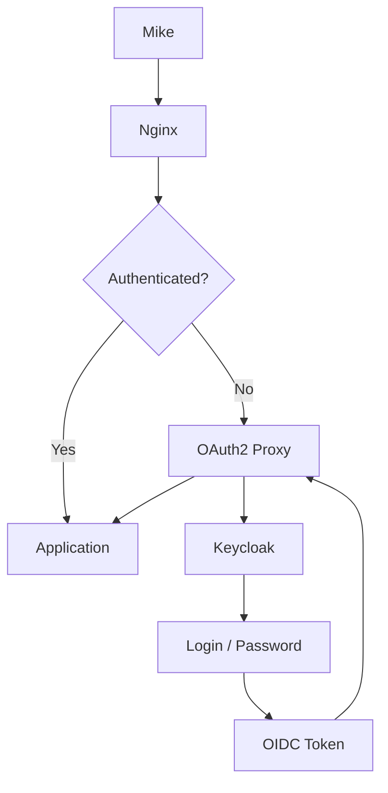

# Oauth2 authentication implementation

## Context

Traditionally, accessing a protected service often meant providing credentials directly. OAuth introduced delegated authorization, allowing applications to receive limited access through tokens instead of handling the user's password. OAuth 2.0 standardized and expanded this model for modern web and API architectures.

## Stack

The purpose of this documentation is to implement an oauth2 solution to authenticate on a web app.

* Web app: very basic [Nginx](https://nginx.org/en/docs/index.html) web app consisting of a index.html
* Oauth2 solution: [Keycloak](https://www.keycloak.org/documentation)
* Infrastructure:
  * Ubuntu24.04 under WSL2
  * [Docker](https://docs.docker.com/)

Our docker stack will consists in 3 services:
* nginx: our web app
* oauth2_proxy: Redirect to oauth2 instance
* Keycloak: Oauth2 instance

## Requirement

* Update the `/etc/hosts` file, for windows usage: `C:\Windows\System32\drivers\etc`
  ```text
  127.0.0.1   localhost keycloak
  ```
* WSL2 or any Hypervisor (HyperV, VMWare, VirtualBox...)
  * [WSL Installation documentation](https://learn.microsoft.com/en-us/windows/wsl/install)

```powershell
PS C:\> wsl --version
WSL version: 2.6.3.0
Kernel version: 6.6.87.2-1
WSLg version: 1.0.71
MSRDC version: 1.2.6353
Direct3D version: 1.611.1-81528511
DXCore version: 10.0.26100.1-240331-1435.ge-release
Windows version: 10.0.26200.9711
```

* Docker
  * [Docker installation on ubuntu documentation](https://docs.docker.com/engine/install/ubuntu/)
```bash
> $ docker version
Client: Docker Engine - Community
 Version:           29.9.2
 API version:       1.56
 Go version:        go1.26.10
 Git commit:        a82e528
 Built:             Tue Oct 20 18:44:40 2026
 OS/Arch:           linux/amd64
 Context:           default

Server: Docker Engine - Community
 Engine:
  Version:          29.9.2
  API version:      1.56 (minimum version 1.40)
  Go version:       go1.26.10
  Git commit:       0367cbe
  Built:            Tue Oct 20 18:44:40 2026
  OS/Arch:          linux/amd64
  Experimental:     false
 containerd:
  Version:          v2.4.2
  GitCommit:        b7a25261e029d68978bbf290df0a62fc819b3c51
 runc:
  Version:          1.5.2
  GitCommit:        v1.5.2-0-g29dd3dc2
 docker-init:
  Version:          0.19.0
  GitCommit:        de40ad0
```


## Stack

### Auth diagram



As described before our stack will run under docker-compose. For each service I will describe the `docker-compose` block and its configuration.
### Requirement

Before configure any service we need a common docker network.

Within docker-compose file
```yaml
services:
    # nginx
    # oauth2-proxy
    # keycloak
networks:
    web:
```

Our docker network will be create when lauching our first `docker compose up`.
Check:
```bash
> $ docker network ls
    NETWORK ID     NAME         DRIVER    SCOPE
    0072503fa7f2   bridge       bridge    local
    0e7185d1e2c6   host         host      local
    10756ce2dcea   none         null      local
    7f1b97eabaca   oauth2_web   bridge    local # <-- Docker network created through docker-compose
```

### Nginx

#### Docker-compose block

__What do we need ?__
* A docker image: `nginx:stable-alpine3.24-slim`, can be found in docker hub. Keep in mind that using `latest` version is NOT a best practise.
* A port sharing: We want to access our web app through port 80
* Volume:
  * nginx configuration
  * html index page
* dependance: `oauth2-proxy` service (which depends on keycloak)
* Within de`web` network

Below the docker compose block:
```yaml
services:
  nginx:
    image: nginx:stable-alpine3.24-slim
    container_name: nginx
    ports:
      - "8080:80"
    volumes:
      - ./nginx.conf:/etc/nginx/conf.d/default.conf:ro
      - ./html:/usr/share/nginx/html:ro
    depends_on:
      oauth2-proxy:
        condition: service_started
    networks:
      - web

networks:
  web:
```

#### Nginx configuration

```conf
server {
    listen 80;
    server_name localhost;
    location = /oauth2/auth {
        internal;

        proxy_pass http://oauth2-proxy:4180/oauth2/auth;

        proxy_set_header X-Original-URI $request_uri;
        proxy_set_header X-Real-IP $remote_addr;

        proxy_pass_request_body off;
        proxy_set_header Content-Length "";
    }
    location /oauth2/ {
        proxy_pass http://oauth2-proxy:4180;

        proxy_set_header Host $host;
        proxy_set_header X-Real-IP $remote_addr;
        proxy_set_header X-Forwarded-Proto $scheme;
        proxy_set_header X-Auth-Request-Redirect $request_uri;
    }

    location / {

        auth_request /oauth2/auth;
        error_page 401 = /oauth2/sign_in;

        root /usr/share/nginx/html;
        index index.html;
    }
}
```

| Nginx directive | Description |
|---|---|
| `listen 80` | Listens for incoming HTTP connections on port `80`. |
| `server_name localhost` | Defines `localhost` as the hostname handled by this server block. |
| `location = /oauth2/auth` | Defines the internal endpoint used to check whether a request is authenticated. |
| `internal` | Prevents clients from accessing `/oauth2/auth` directly. |
| `proxy_pass http://oauth2-proxy:4180/oauth2/auth` | Forwards authentication checks to OAuth2 Proxy. |
| `proxy_set_header X-Original-URI $request_uri` | Sends the originally requested URI to OAuth2 Proxy. |
| `proxy_set_header X-Real-IP $remote_addr` | Sends the client's IP address to OAuth2 Proxy. |
| `proxy_pass_request_body off` | Prevents the original request body from being forwarded during the authentication check. |
| `proxy_set_header Content-Length ""` | Clears `Content-Length` because the authentication subrequest has no body. |
| `location /oauth2/` | Handles OAuth2 Proxy endpoints such as sign-in and callback. |
| `proxy_pass http://oauth2-proxy:4180` | Forwards `/oauth2/` requests to OAuth2 Proxy. |
| `proxy_set_header Host $host` | Preserves the original hostname. |
| `proxy_set_header X-Forwarded-Proto $scheme` | Tells OAuth2 Proxy whether the original request used HTTP or HTTPS. |
| `proxy_set_header X-Auth-Request-Redirect $request_uri` | Provides the URI to return to after authentication. |
| `location /` | Defines the main protected website location. |
| `auth_request /oauth2/auth` | Performs an authentication subrequest before serving the requested resource. |
| `error_page 401 = /oauth2/sign_in` | Sends unauthenticated users to the OAuth2 Proxy sign-in endpoint. |
| `root /usr/share/nginx/html` | Defines the directory containing the website's static files. |
| `index index.html` | Defines `index.html` as the default file. |

### Oauth2-proxy

__What do we need ?__
* A docker image: `dhi.io/oauth2-proxy:7-debian`
* environment variable:
  * `OAUTH2_PROXY_PROVIDER: oidc`: make oauth2 using oidc protocol
  * `OAUTH2_PROXY_OIDC_ISSUER_URL: http://keycloak:8081/realms/myrealm`: OIDC instance(keycloak container instance in this case)
  * `OAUTH2_PROXY_CLIENT_ID: my_client_id`: App id within keycloak, this id will be used in the keycloak configuration
  * `OAUTH2_PROXY_CLIENT_SECRET: my_client_secret`: client secret related to client id
  * `OAUTH2_PROXY_COOKIE_SECRET: 3uqI94f3RBMOIRDxFmQ35sr33HuKHJ370NkV_T1eUpI=`: This secret is used by oauth2 to secure cookie sessionsymmetric encryption secret used to secure OAuth2 Proxy session cookies. To generate it, use the following command:`openssl rand -base64 32 | tr '+/' '-_'`
  * `OAUTH2_PROXY_EMAIL_DOMAINS: "*"` Control allowed domain. `*` means all email address. In a company context we would have set it to `mycomany.com`
  * `OAUTH2_PROXY_HTTP_ADDRESS: "0.0.0.0:4180"`: Address and port where oauth2_proxy is listening
  * `OAUTH2_PROXY_REDIRECT_URL: "http://localhost:8080/oauth2/callback"`: Once Keycloak has done the authentication it will sent this url:
    ```text
        Browser
        │
        ▼
        Keycloak login
        │
        │ authentication OK
        ▼
        http://localhost:8080/oauth2/callback
        │
        ▼
        oauth2-proxy
    ```
  * `OAUTH2_PROXY_REVERSE_PROXY: "true"`:In our architecture oauth2 in behind an nginx reverse proxy.
  * `OAUTH2_PROXY_SET_XAUTHREQUEST: "true"`: This setting is related to the Nginx integration. It exposes authentication information to Nginx through the response headers of /oauth2/auth, which Nginx can then forward to the application.

__RECAP__
| Environment Variable | Purpose |
|---|---|
| `OAUTH2_PROXY_PROVIDER` | Defines the authentication provider/protocol used by OAuth2 Proxy, in this case `oidc`. |
| `OAUTH2_PROXY_OIDC_ISSUER_URL` | URL of the OIDC provider/issuer, in this case the Keycloak realm. |
| `OAUTH2_PROXY_CLIENT_ID` | Identifies OAuth2 Proxy as a client registered with Keycloak. |
| `OAUTH2_PROXY_CLIENT_SECRET` | Secret used by OAuth2 Proxy to authenticate itself as the registered client with Keycloak. |
| `OAUTH2_PROXY_COOKIE_SECRET` | Secret used by OAuth2 Proxy to secure its session cookies. |
| `OAUTH2_PROXY_EMAIL_DOMAINS` | Defines which email domains are allowed to authenticate. `*` allows all email domains. |
| `OAUTH2_PROXY_HTTP_ADDRESS` | Defines the address and port on which OAuth2 Proxy listens for HTTP connections. |
| `OAUTH2_PROXY_REDIRECT_URL` | Callback URL to which the browser is redirected after authentication with the OIDC provider. |
| `OAUTH2_PROXY_REVERSE_PROXY` | Enables operation behind a reverse proxy such as Nginx. |
| `OAUTH2_PROXY_SET_XAUTHREQUEST` | Makes authentication information available through `X-Auth-Request-*` headers for use by Nginx and upstream applications. |

Below the `docker-compose.yaml` block:
```yaml
  oauth2-proxy:
    image: dhi.io/oauth2-proxy:7-debian
    container_name: oauth2-proxy
    environment:
      OAUTH2_PROXY_PROVIDER: oidc
      OAUTH2_PROXY_OIDC_ISSUER_URL: ${OIDC_ISSUER_URL}
      OAUTH2_PROXY_CLIENT_ID: ${CLIENT_ID}
      OAUTH2_PROXY_CLIENT_SECRET: ${CLIENT_SECRET}
      OAUTH2_PROXY_COOKIE_SECRET: ${COOKIE_SECRET}
      OAUTH2_PROXY_EMAIL_DOMAINS: "*"
      OAUTH2_PROXY_HTTP_ADDRESS: "0.0.0.0:4180"
      OAUTH2_PROXY_REDIRECT_URL: "http://localhost:8080/oauth2/callback"
      OAUTH2_PROXY_REVERSE_PROXY: "true"
      OAUTH2_PROXY_SET_XAUTHREQUEST: "true"
    depends_on:
      keycloak:
        condition: service_healthy
        restart: true
    networks:
      - web
```

Note that variable are protected below a `.env` file:
```
CLIENT_ID=my_client_id
CLIENT_SECRET=my_client_secret
OIDC_ISSUER_URL=http://keycloak:8081/realms/myrealm
COOKIE_SECRET=3uqI94f3RBMOIRDxFmQ35sr33HuKHJ370NkV_T1eUpI=
KC_BOOTSTRAP_ADMIN_USERNAME=kc_admin
KC_BOOTSTRAP_ADMIN_PASSWORD=kc_passwd
``` 

### Keycloak